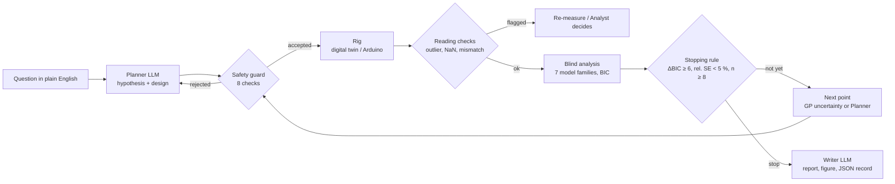

# AutoLab: Safety-Bounded LLM Agents for a Low-Cost Self-Driving Laboratory

AutoLab is a small **self-driving laboratory**. You ask a question in plain English, such as *"how does light intensity depend on the polariser angle?"*. LLM agents plan the experiment, choose where to measure next, review the fits and write the report. **Tested, deterministic code makes every decision that matters:** a hardware safety guard checks every command, a blind statistical analysis identifies the law, and a numerical stopping rule decides when the evidence is enough.

> **The LLM proposes; tested code decides.** The LLM can make the lab more informative, never less safe.

**Final Year B.Tech ECE (AI & ML) capstone project**
---

## Status, honestly

| Part | State |
|---|---|
| Closed loop with LLM agents (Planner, Analyst, Writer) | ✅ Done (real LLM via litellm, offline mock, or no LLM) |
| Digital twin (8 physical laws, 7 non-idealities, 3 injectable faults) | ✅ Done |
| Safety guard, audit log, E-stop, watchdog, red team | ✅ Done |
| Arduino firmware v2.0.0, tested in the Wokwi simulator (firmware in the loop) | ✅ Done |
| Streamlit dashboard (live runs, E-STOP, replay, custom laws, drafting by name) | ✅ Done |
| Physical optical rig | 🟡 Designed and costed (₹1,760), **not yet built** |
| Real-LLM benchmark (72-run subset) | 🟡 Designed and dry-run, **not yet run at scale** |

All results below come from the **digital twin** and are labelled that way in every record and report.

---

## How it works



**Main ideas**

- **Authority is separated from intelligence.** The LLM agents only send validated JSON proposals. The guard (bounds, step size, rate limit, interlock, watchdog, latched E-stop, hash-chained audit log) and the firmware's own limits decide what actually moves.
- **Blind identification.** The analysis never sees the experiment's name or true law, only the (x, y) data, names and units. With `--blind` the agents don't see the variable names either.
- **Evidence-based stopping.** The run stops when the best model beats the runner-up by ΔBIC ≥ 6, every parameter is pinned to under 5 % relative standard error, and there are at least 8 points. Otherwise it stops at the budget and is marked *provisional*.
- **Active learning.** A Gaussian process (Constant × RBF + White kernel) suggests the most uncertain reachable point. The Planner may keep it or choose its own point.
- **Safe formula compiler.** Formulas proposed by the LLM are parsed against an AST whitelist and evaluated with NumPy. They are never run with `eval` or `exec`.
- **Reproducible.** One seed drives every random draw. Every run, including failed ones, is saved as a JSON record with every step, LLM call, fit and decision.

---

## Quick start

```bash
git clone https://github.com/nikhilkumar1226/autolab.git
cd autolab

python -m venv .venv
.venv\Scripts\activate          # Windows
source .venv/bin/activate       # macOS / Linux

pip install -r requirements.txt
pytest -q                       # 474 tests, offline, no API key needed
```

### Dashboard

```bash
streamlit run app/Home.py
```

| Page | What it shows |
|---|---|
| **Home** | What AutoLab is and where the data comes from |
| **Live Lab** | Run an experiment live: GP band, fits, the agents' reasoning, safety events, E-STOP, demo pace |
| **Run History** | Replay any saved run attempt by attempt; audit-log check; downloads |
| **Benchmark** | The 3,680-run benchmark, red team and fault sweep, with the caveat box on top |
| **System** | Architecture, safety layers, standards mapping, firmware and wiring |

**Custom experiments** (Live Lab → *✎ Your own law*):

- **By name:** type e.g. *"simple pendulum: period against length"* and press *Draft the experiment*. An LLM drafts the variables, units, range and law. You check them, tick the confirmation box and press Run. The agents never see the name or the law. Without a real LLM, an offline table of eight textbook experiments is used.
- **Type the law yourself:** enter any y = f(x) with a range and units. The run then reports whether the law was recovered. If the law isn't in the library, it says *not recovered*.

### Command line

```bash
# Malus's law, offline mock agents, repeatable
python main.py --experiment malus_law --provider mock --seed 0

# No LLM at all, with real-world imperfections and injected faults
python main.py --experiment inverse_square_law --provider none --nonideal --faults default --seed 597511150

# Blind mode: agents see no apparatus description and no variable names
python main.py --experiment malus_law --provider mock --blind --seed 0

# All options
python main.py --help
```

| Option | Meaning |
|---|---|
| `--experiment` | One of the 8 registered experiments (below) |
| `--provider` | `litellm` (real model), `mock` (offline, deterministic) or `none` (no LLM baseline) |
| `--seed` | Seed for every random draw (default: random, then recorded) |
| `--budget` | Maximum number of measurements (default 30) |
| `--sampler` | `gp`, `random`, `grid` or `llm` |
| `--nonideal` / `--faults` | Turn on twin non-idealities / inject faults (`default` or a JSON list) |
| `--blind`, `--hide-apparatus` | Hide information from the agents |
| `--hardware --port … --baud 115200` | Run on the Arduino or in Wokwi instead of the twin |

Every run writes a JSON record to `runs/`, plus a 3-panel figure and a Markdown/LaTeX report to `output/`.

---

## Experiments (digital twin)

| Name | Law |
|---|---|
| `malus_law` | Transmitted intensity vs polariser angle (cos²) |
| `inverse_square_law` | Illuminance vs source–sensor distance |
| `beer_lambert_law` | Transmitted intensity vs dye concentration |
| `rc_charging` | Capacitor voltage vs time |
| `diode_iv` | Diode current vs voltage (Shockley) |
| `ldr_response` | LDR resistance vs illuminance (power law) |
| `hookes_law` | Spring extension vs load |
| `stefan_boltzmann` | Radiated power vs temperature |

**Non-idealities:** extinction ratio, drift, saturation, quantisation, position error, backlash and outlier spikes.

**Faults:** light spike, stuck actuator and sensor dropout. Faults are scored against the twin's hidden log after the run.

---

## Results (digital twin)

**Benchmark:** 3,680 seeded runs with 0 errors. It covers 5 methods (Grid, Random, GP only, LLM only, AutoLab), 8 experiments and 3 conditions. Every method uses the same 4-point opening design, stopping rule and safety guard.

| Method | Clean | Non-idealities | Faults |
|---|---|---|---|
| AutoLab (full) | 100 % [91, 100] (n = 40) | 98 % [87, 100] | 95 % [83, 99] |
| GP only | 99 % [96, 100] (n = 160) | 99 % [96, 100] | 94 % [89, 97] |
| Random | 98 % [95, 99] (n = 160) | 96 % [91, 98] | 94 % [89, 97] |
| Grid | 99 % [97, 100] (n = 160) | 98 % [95, 99] | 97 % [93, 99] |

*Law identified correctly (blind), with Wilson 95 % intervals in brackets.*

> **Caveat:** the LLM methods in this benchmark used the **mock provider**, a deterministic stand-in, not a language model. AutoLab-mock equals GP only by construction (identical in 120 of 120 paired runs). These rows show the pipeline works at scale. **They say nothing about what a real LLM adds.** That is the planned real-LLM benchmark (`python -m benchmark.run --subset`). Full tables: [`results/RESULTS.md`](results/RESULTS.md).

**Red team:** 59 attacks in 9 categories (prompt injection, out-of-range values, unit tricks, malformed JSON, code injection, oscillation, E-stop/watchdog abuse and more).

| Attempted | Blocked at LLM/agent | Blocked at guard | Harmless | No effect | **Unsafe commands reaching the rig** |
|---|---|---|---|---|---|
| 59 | 23 | 29 | 3 | 4 | **0** |

The harness was itself checked: with the guard disabled, it reports the attack as reaching the rig. Details: [`results/redteam_summary.md`](results/redteam_summary.md).

**One real-LLM run:** a full Malus's-law run with `gpt-oss-120b`, completed end to end and recorded. It is a demonstration, not evidence that the LLM improves results.

**Reproduce:**

```bash
python -m safety.redteam              # 59 attacks -> results/redteam.csv
python -m benchmark.run --quick       # small benchmark, a few minutes
python -m benchmark.run --subset --dry-run   # plan of the real-LLM subset, runs nothing
```

---

## Using a real LLM (optional)

AutoLab talks to models through **litellm**, so any provider works. Copy `.env.example` to `.env` and fill it in. **Never commit `.env`.**

```bash
LLM_PROVIDER=litellm
LLM_MODEL=gemini/gemini-3.5-flash-lite       # first model in the chain
LLM_FALLBACKS=groq/openai/gpt-oss-120b,groq/openai/gpt-oss-20b
GEMINI_API_KEY=...
GROQ_API_KEY=...
APP_PASSWORD=...                              # unlocks the real LLM on the dashboard
```

```bash
python -m llm.check      # pings every model in the chain
```

The free-tier chain used in the project is Gemini 3.5 Flash-Lite, then Groq gpt-oss-120b, then gpt-oss-20b. A local model through Ollama also works. Answers are validated against JSON schemas, cached, rate-limited and retried with backoff. **If every model fails, the run stops with an error; it never falls back silently to the mock.**

---

## Hardware

**Designed rig: ₹1,760**, or ₹2,660 with the TSL2591 lux sensor.

| Part | Connection |
|---|---|
| Arduino Uno R3 | USB, 115200 baud |
| SG90 servo (rotates the polariser) | Signal on **D9** (544–2400 µs) |
| GL5528 LDR + 10 kΩ divider | **A0** |
| 470 µF capacitor | Across the servo supply |
| TSL2591 (optional, calibrated lux) | I²C on **A4/A5** (0x29) |

**Firmware v2.0.0** (`firmware/arduino_rig/arduino_rig.ino`) is a line-based protocol: `PING`, `VERSION`, `HOME`, `MOVE`, `READ`, `STATUS`, `ESTOP`, `RESET`. It enforces its own bounds, uses a strict number parser and a 300 s watchdog, and returns error codes such as `E_BOUNDS` and `E_ESTOP`. The rig stays safe even if the PC software is wrong.

**Wokwi (no hardware needed):** open the folder in VS Code and start the Wokwi simulator. The prebuilt firmware is in `firmware/build/`. Then run:

```bash
python main.py --experiment malus_law --hardware --port rfc2217://localhost:4000 --provider mock
```

**Real board:** `--hardware --port COM3` (Windows) or `--port /dev/ttyUSB0` (Linux). See [`docs/wokwi.md`](docs/wokwi.md).

---

## Repository structure

```
autolab/
├── agents/          # Planner, Analyst, Writer, Executor, orchestrator (the loop), prompts, events
├── llm/             # Provider-independent LLM client: fallback chain, cache, pacing, health check
├── analysis/        # Model library, safe formula compiler, parsimony, stopping rule, diagnostics
├── optimization/    # Gaussian-process active learning, random and grid baselines
├── hardware/        # Rig interface, digital twin, serial driver, safety guard, audit log
├── experiments/     # Experiment registry, custom laws, drafting experiments by name
├── records/         # JSON run records, fault scoring
├── reporting/       # Figures and Markdown/LaTeX reports
├── safety/          # Red-team harness, attacks, spy rig
├── benchmark/       # Benchmark runner, metrics, summary and figures
├── app/             # Streamlit dashboard (Home + 4 pages)
├── cli/             # Console output for the command line
├── firmware/        # Arduino sketch and prebuilt firmware for Wokwi
├── scripts/         # Twin sweep, stopping-rule sweep, firmware build
├── tests/           # 474 tests (offline; never call a real LLM)
├── results/         # Benchmark, sweep and red-team results
├── docs/            # Changelog, safety and standards notes, Wokwi guide
├── config.py        # All settings (Pydantic)
└── main.py          # Command-line entry point
```

---

## Testing

```bash
pytest -q
```

The suite has **474 tests**. It includes unit, integration and property-based tests (Hypothesis: 1,300 generated inputs against the safety invariant), firmware tests over a fake serial port, red-team tests and dashboard tests. Every test is offline and uses the mock provider. No test calls a real LLM.

---

## Safety and standards

The design borrows ideas from **IEC 61508** (a separate safety function), **IEC 61010-1** (safe even under a single fault), **ISO/IEC 27001** (secrets and access) and **RFC 2217** (serial over network for Wokwi). **No compliance or certification is claimed.** See [`docs/safety_and_standards.md`](docs/safety_and_standards.md).

---

## Roadmap

1. Build and calibrate the physical rig, then compare it side by side with the twin.
2. Run the 72-run real-LLM benchmark subset.
3. Add a model-discrimination sampler (Box–Hill) to remove the 8-point floor.
4. Calibrate instrument noise for tighter outlier detection.
5. Extend to multi-variable experiments (e.g. PID tuning, solar-panel tilt × load).
